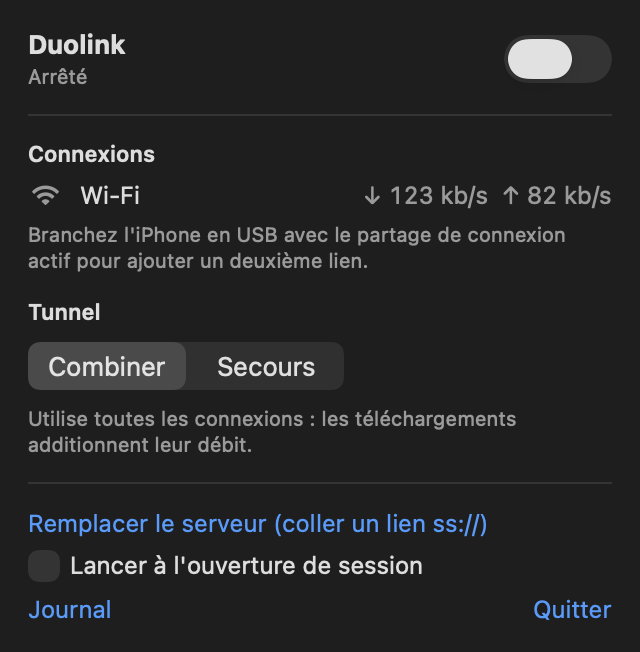

# Duolink

Additionne le Wi-Fi et le partage de connexion de l'iPhone sur un Mac, comme [Speedify](https://speedify.com), avec votre propre serveur. Pensé pour le train : le Wi-Fi de bord et la 4G du téléphone passent par des opérateurs différents, et Duolink utilise les deux en même temps.



## Fonctionnement

```
Apps du Mac
   │  proxy système (SOCKS5 + HTTP, 127.0.0.1:20802)
   ▼
sing-box (client Shadowsocks 2022, chiffré)
   │  TCP local (127.0.0.1:20801)
   ▼
Relais MPTCP (Network.framework, mode aggregate)
   ├── sous-flux via le Wi-Fi du train ──┐
   └── sous-flux via l'iPhone en USB ────┤
                                         ▼
                       VPS : noyau Linux MPTCP + sing-box (serveur Shadowsocks)
                                         │
                                         ▼
                                     Internet
```

Une connexion **Multipath TCP** (RFC 8684) répartit les paquets d'un même flux sur plusieurs interfaces. Le serveur les remet dans l'ordre et sort sur Internet avec une seule IP. Un téléchargement unique profite donc des deux liens, et une connexion survit à la perte d'un des deux.

Duolink n'implémente aucun protocole lui-même. Il assemble des briques reconnues :

| Brique | Rôle |
|---|---|
| [MPTCP de macOS](https://developer.apple.com/documentation/network/nwparameters/multipathservicetype) | Le même que celui utilisé par Siri et Plans. Seul Network.framework l'expose aux apps tierces. |
| [MPTCP du noyau Linux](https://www.mptcp.dev) | Intégré au noyau depuis la version 5.6. |
| [sing-box](https://github.com/SagerNet/sing-box) | Proxy universel (plus de 38 000 étoiles). Fournit le chiffrement Shadowsocks 2022, le proxy local et le réglage du proxy système. |

Le code propre à Duolink est un petit relais en Swift et l'app de barre de menus. sing-box ne peut pas ouvrir de socket MPTCP sur macOS (Go ne le gère que sous Linux). Il parle donc en TCP simple au relais, et c'est le relais qui ouvre la connexion multichemin vers le serveur.

## Prérequis

- Un Mac sous macOS 14 ou plus récent, avec les outils Xcode et [Homebrew](https://brew.sh).
- Un VPS Linux avec un noyau 5.15 ou plus récent et Docker. Choisissez-le proche de chez vous : chaque requête fait l'aller-retour par lui.

## Installation du serveur

Sur le VPS :

```sh
git clone https://github.com/leo-mathurin/duolink.git
cd duolink/server
./install.sh            # PORT=8443 par défaut
```

Le script :

- règle les limites MPTCP (8 sous-flux) avec un service systemd ;
- active BBR, plus efficace sur les liens cellulaires qui perdent des paquets (`ENABLE_BBR=0` pour ne pas le faire) ;
- ouvre le port dans iptables, y compris dans `/etc/iptables/rules.v4` ;
- génère un mot de passe et lance sing-box dans Docker, en réseau `host` pour garder le MPTCP de bout en bout ;
- affiche un lien `ss://` à coller dans l'app.

Ouvrez aussi le port TCP dans le pare-feu de votre hébergeur. Sur Oracle Cloud, ajoutez une règle d'entrée TCP 8443 à la liste de sécurité du sous-réseau ou au groupe de sécurité réseau de l'instance, par exemple :

```sh
oci network nsg rules add --nsg-id <ocid-du-nsg> --security-rules \
  '[{"direction":"INGRESS","protocol":"6","source":"0.0.0.0/0","sourceType":"CIDR_BLOCK","tcpOptions":{"destinationPortRange":{"min":8443,"max":8443}}}]'
```

## Installation sur le Mac

```sh
brew install sing-box
git clone https://github.com/leo-mathurin/duolink.git
cd duolink
./scripts/build-app.sh --install
```

Puis, dans le menu Duolink :

1. Copiez le lien `ss://` affiché par le serveur et cliquez sur **Coller le lien ss://**.
2. Cliquez sur **Autoriser l'agrégation** et entrez votre mot de passe administrateur (une seule fois, voir plus bas).
3. Activez l'interrupteur.

## Dans le train

1. Connectez-vous au Wi-Fi du train et validez son portail. Le portail `wifi.sncf` reste joignable quand Duolink est actif.
2. Activez le partage de connexion sur l'iPhone et branchez-le **en USB**. Le Mac n'a qu'une carte Wi-Fi : il ne peut pas rejoindre deux réseaux Wi-Fi en même temps.
3. Les deux liens apparaissent dans le menu avec leur débit. Pendant un téléchargement, les deux doivent bouger. Ces compteurs incluent aussi le trafic hors tunnel : pour une preuve stricte, `ss -Mni` sur le VPS montre les sous-flux de chaque connexion.

Si le Wi-Fi est connecté mais sans Internet (portail pas encore validé, tunnel, liaison du train coupée), une connexion qui n'aboutit pas en 2,5 secondes est relancée en évitant cette interface, donc via l'iPhone. Le Wi-Fi rejoint la connexion plus tard s'il revient.

Si le serveur ne répond plus, le menu affiche une alerte rouge : les apps qui passent par le proxy n'ont alors plus Internet. Désactivez Duolink pour repasser en direct.

### Modes

| Mode | Comportement |
|---|---|
| **Agréger** | Envoie sur toutes les interfaces en même temps pour additionner les débits. |
| **Réactif** | Utilise l'interface la plus rapide et déborde sur l'autre quand elle sature. |
| **Secours** | Utilise une seule interface et bascule sans couper les connexions si elle tombe. Économise le forfait de l'iPhone. |

### Pourquoi un mot de passe administrateur

macOS refuse le mode MPTCP « aggregate » aux apps tierces tant que le réglage `net.inet.mptcp.allow_aggregate` vaut 0. Ce réglage revient à 0 à chaque redémarrage. Duolink installe donc un LaunchDaemon (`/Library/LaunchDaemons/io.github.leo-mathurin.duolink.allow-aggregate.plist`) qui le remet à 1 au démarrage. Sans cette autorisation, Duolink utilise le mode Réactif.

Pour le faire à la main : `dist/duolinkctl allow-aggregate | sudo sh`.

## Limites

- **Seules les apps qui respectent le proxy système passent par le tunnel** : navigateurs, la plupart des apps macOS, `curl` avec `-x`. Les autres sortent en direct, sans agrégation.
- **L'UDP passe dans le flux TCP** (UDP over TCP). Il est agrégé, mais un appel vidéo en UDP peut subir plus de latence qu'en direct. Les navigateurs n'utilisent pas QUIC à travers un proxy, ils restent donc en TCP agrégé.
- **Le gain dépend du réseau.** Le Wi-Fi du train est lui-même une liaison 4G sur le toit, et il traverse les mêmes tunnels et zones blanches que votre téléphone. Le gain le plus visible est la continuité : quand un lien tombe, les connexions continuent sur l'autre.
- **Portails captifs** : seuls `wifi.sncf`, `captive.apple.com`, les domaines `.local` et les adresses privées restent en direct. Sur un autre réseau, désactivez Duolink le temps de valider le portail.
- **Le forfait de l'iPhone est consommé** en mode Agréger. Passez en mode Secours pour l'économiser.
- **Si l'app est tuée brutalement**, le proxy système peut rester actif et couper Internet. Relancez Duolink : il arrête l'ancien sing-box et restaure le réglage. Sinon, désactivez les proxys dans Réglages Système > Réseau > Wi-Fi > Proxys.

## Outil en ligne de commande

`duolinkctl` lance le même tunnel sans interface, pratique pour tester :

```sh
DUOLINK_LINK='ss://...' dist/duolinkctl aggregate                 # proxy sur 127.0.0.1:20802
DUOLINK_LINK='ss://...' dist/duolinkctl interactive --system-proxy
```

Pour vérifier que le serveur reçoit bien du MPTCP : `ss -Mni` sur le VPS liste les connexions MPTCP et leurs sous-flux.

## Désinstallation

```sh
rm -rf /Applications/Duolink.app ~/Library/Application\ Support/Duolink
sudo launchctl bootout system/io.github.leo-mathurin.duolink.allow-aggregate
sudo rm /Library/LaunchDaemons/io.github.leo-mathurin.duolink.allow-aggregate.plist
```

Sur le serveur : `docker compose down` dans `server/`, puis `sudo systemctl disable --now duolink-mptcp`.

## Développement

```sh
cd client
swift test
```

Les tests couvrent l'analyse des liens `ss://`, la config sing-box (validée par `sing-box check` si le binaire est installé), le compteur de débit et le relais sur la boucle locale.

## Licence

MIT
